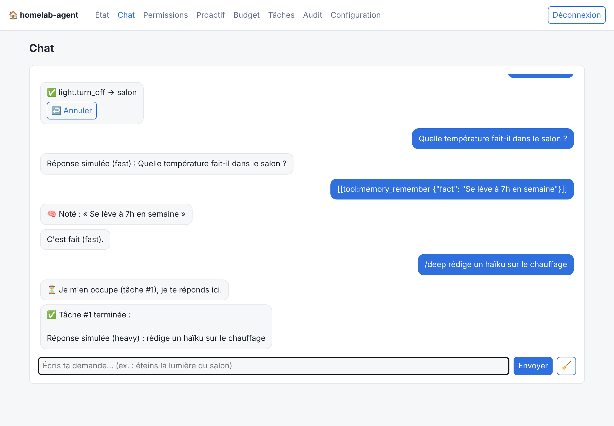
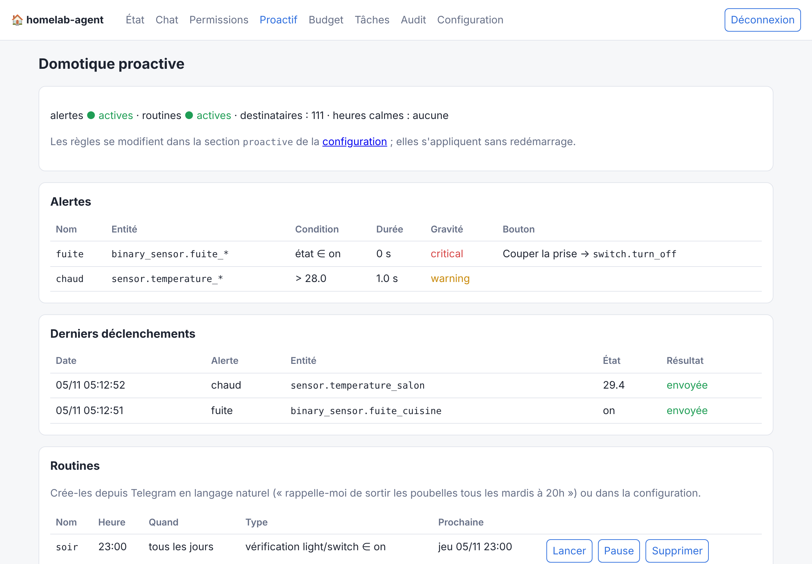
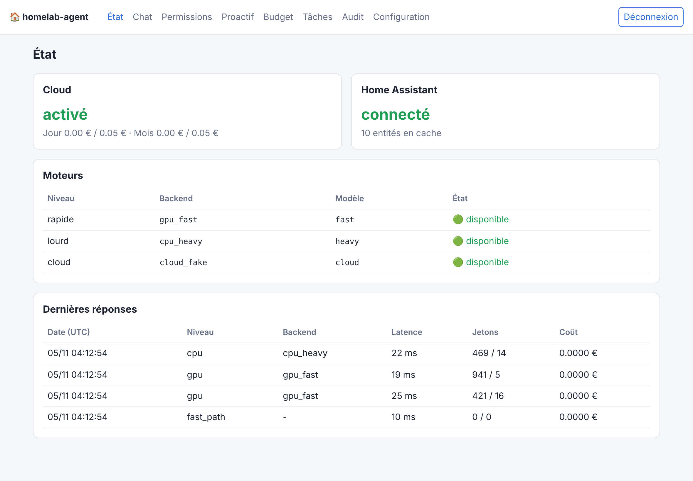
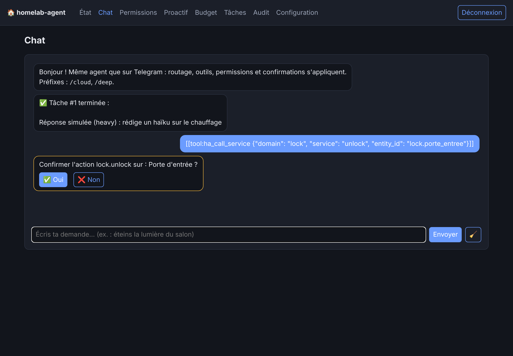

# homelab-agent

[](https://github.com/FrancoisPJ/HomeLab-Agent/actions/workflows/ci.yml)
[](https://github.com/FrancoisPJ/HomeLab-Agent/actions/workflows/codeql.yml)
[](pyproject.toml)
[](LICENSE)

Un agent IA personnel, piloté depuis **Telegram**, qui tourne chez soi avec `docker compose`.
Chaque demande est envoyée au moteur le plus adapté :

| Niveau | Rôle | Moteur |
|---|---|---|
| **Rapide (GPU)** | réponses instantanées, choix d'outil, domotique (« éteins la lumière ») | `llama.cpp` sur GPU, petit modèle chargé à la demande, modèle « qualité » si la VRAM le permet |
| **Lourd (CPU)** | tâches longues non urgentes, en arrière-plan | `llama.cpp` sur CPU, modèle plus gros |
| **Cloud** | tâches très complexes ou urgentes | API Claude (Anthropic) / API Gemini (Google) |

Il pilote **Home Assistant** (lecture et contrôle), avec des **permissions appliquées par le code**
et réglables dans un **panneau web**. Il peut aussi **prévenir** (fuite, porte ouverte, température)
avec un bouton d'action, et lancer des **routines** à heure fixe, que tu crées en lui parlant
(« rappelle-moi de sortir les poubelles tous les mardis à 20h ») ([docs/proactive.md](docs/proactive.md)).
Les **messages vocaux** Telegram sont transcrits en local avec whisper.cpp, et l'agent peut
**répondre de vive voix** avec Piper ([docs/voice.md](docs/voice.md)).

> ⚠️ Le projet a été développé et testé **sans accès au matériel réel** : la CI utilise des faux
> services (LLM, Home Assistant, Telegram). Avant d'en dépendre, déroulez la
> [checklist de recette](docs/deployment.md#checklist-de-recette-sur-le-vrai-matériel).

## Aperçu

| Chat du panneau (streaming, bouton ↩️ Annuler, mémoire, tâche CPU) | Domotique proactive |
|---|---|
|  |  |
| **État des moteurs et dernières réponses** | **Confirmation d'une action sensible (thème sombre)** |
|  |  |

<sub>Captures de la stack `make dev` : les moteurs, Home Assistant et Telegram y sont simulés (d'où
les « Réponse simulée »). Autres pages : [permissions](docs/images/permissions.png),
[audit](docs/images/audit.png).</sub>

## Architecture

```
Telegram ─► gateway ─► orchestrateur ─► routeur ─┬─► GPU   llama-swap → llama-server (CUDA)
  (long polling)            │                    ├─► CPU   llama-swap → llama-server (file de jobs)
                            │                    └─► cloud Claude / Gemini (budget plafonné)
                            └─► outils ─► Home Assistant (REST + WebSocket)
                                  ▲
               moteur de permissions + journal d'audit
Panneau web (127.0.0.1) : état, permissions, budget, jobs, audit, configuration
SQLite : conversations, jobs, dépenses, audit
```

Le routeur procède en entonnoir : **chemin rapide sans LLM** (commandes triviales) → **GPU** →
**escalade** (mots-clés, longueur, `/cloud`, `/deep`, demande du modèle, échecs d'outils) →
**CPU asynchrone** ou **cloud synchrone** → **repli** sur le niveau voisin si un moteur tombe ou si
le budget est atteint. Détails : [docs/architecture.md](docs/architecture.md).

## Prérequis

- Docker + Docker Compose v2.24 ou plus récent ;
- pour le GPU : pilote NVIDIA (535 / CUDA 12.2 suffit) et le **NVIDIA Container Toolkit** ;
- un bot Telegram (token de [@BotFather](https://t.me/BotFather)) et votre identifiant numérique ;
- un token longue durée Home Assistant ;
- [uv](https://docs.astral.sh/uv/) sur l'hôte pour les commandes `make` (validation, modèles) ;
- environ 17 Go de disque pour les trois modèles proposés.

## Démarrage en 5 commandes

```bash
git clone https://github.com/FrancoisPJ/HomeLab-Agent.git && cd HomeLab-Agent
make init                 # crée .env et config.yaml depuis les exemples
nano .env config.yaml     # tokens, votre identifiant Telegram, URL de Home Assistant
make models               # télécharge les modèles GGUF choisis dans config.yaml (+ SHA256)
make up                   # construit et démarre (profil full : agent + GPU + CPU)
```

Sans `make` : `cp .env.example .env && cp config.example.yaml config.yaml`, puis
`uv run homelab-agent render-engines -o engines`, `./scripts/download-models.sh` et
`docker compose --profile full up -d --build`.

Le panneau est ensuite sur <http://127.0.0.1:8099> (mot de passe `PANEL_PASSWORD`), avec un **chat**
intégré pour parler à l'agent sans Telegram. Sur un serveur
distant : `ssh -L 8099:127.0.0.1:8099 serveur`.

## Profils Compose

| Profil | Services | Usage |
|---|---|---|
| `full` | agent, llama-gpu, llama-cpu | serveur avec GPU NVIDIA |
| `cpu-only` | agent, llama-cpu | pas de GPU : avec `make init PRESET=cpu-only`, un petit modèle CPU sert le niveau rapide |
| `no-gpu` | agent | moteurs hébergés ailleurs (changez les `url`) ou cloud seul |
| `voice` | whisper (transcription) et tts (Piper) | à ajouter : `make up PROFILE=full,voice` |
| `dev` | agent + faux LLM, faux Home Assistant, fausse API Telegram, faux STT | développement, démo, tests e2e |

`make up PROFILE=cpu-only`, `make dev` (rechargement à chaud), `make e2e` (scénario complet).

## Choisir les modèles et le reste de la configuration

Tout se règle dans **`config.yaml`** (validé par un schéma, `config.schema.json`, que VS Code utilise
pour l'autocomplétion) :

- **modèles locaux** : section `models.items` (dépôt Hugging Face, fichier GGUF, SHA256, contexte,
  couches GPU, cache quantifié, délai de déchargement). Puis `make engines models restart`.
  Candidats et méthode : [docs/models.md](docs/models.md) ;
- **moteurs et routage** : `backends`, `routing.tiers`, mots-clés d'escalade, ordre de repli ;
- **modèles cloud, tarifs et plafonds** : `backends.claude.model`, `backends.gemini.model`,
  `cloud.pricing`, `cloud.limits` ([docs/cloud-budget.md](docs/cloud-budget.md)) ;
- **Home Assistant** : politique par défaut, règles, confirmations ([docs/home-assistant.md](docs/home-assistant.md)) ;
- **Telegram** : liste blanche, rythme du streaming ([docs/telegram.md](docs/telegram.md)) ;
- **alertes et routines** : section `proactive` ([docs/proactive.md](docs/proactive.md)) ;
- **voix** : section `voice` et modèle `engine: whisper` ([docs/voice.md](docs/voice.md)).

Référence complète : [docs/configuration.md](docs/configuration.md). Vérification : `make check`.

## Commandes Telegram

`/maison` (télécommande à boutons, sans LLM), `/annuler`, `/memoire`, `/status`, `/model`, `/cloud <texte>` (forcer le cloud), `/deep <texte>` (forcer le CPU, réponse
différée), `/jobs`, `/reset`, `/alerts`, `/routines`, `/run <routine>`,
`/routine on|off|delete <routine>`, `/help`. Tout autre message part dans l'entonnoir de routage.

## Développement

```bash
make setup      # uv sync + hooks pre-commit
make lint typecheck test
make dev        # stack complète avec faux services, sur http://127.0.0.1:8099 (dev-password-123)
make e2e
```

Pile : Python 3.12, uv, FastAPI, pydantic v2, httpx, SQLAlchemy 2 (SQLite), aiogram 3, Jinja2 + HTMX,
SDK `anthropic` et `google-genai`, ruff, mypy --strict, pytest.

## CI/CD

- **CI** ([ci.yml](.github/workflows/ci.yml)) à chaque push/PR : ruff, mypy --strict, schéma à jour,
  tests unitaires et d'intégration (faux backends), gitleaks sur tout l'historique, construction des
  4 images Docker (sans push), scénario e2e Compose.
- **CD** ([release.yml](.github/workflows/release.yml)) : chaque push sur `main` publie des images
  `edge` sur `ghcr.io/<propriétaire>/homelab-agent-*` (sauf l'image CUDA, longue à compiler) ; un tag
  `vX.Y.Z` ou une release publie toutes les images versionnées, CUDA comprise.

## FAQ

**Ça dépense de l'argent ?** Non par défaut : `cloud.enabled: false` et plafonds à 0 €. Les
abonnements grand public (Claude, Gemini) ne fournissent pas de clé API ; l'API se facture à part.

**Faut-il ouvrir un port ?** Non. Telegram fonctionne en *long polling* ; le panneau n'écoute que sur
`127.0.0.1`.

**Et si Jellyfin occupe la VRAM ?** Le modèle GPU est chargé à la demande et déchargé après
inactivité ; si le chargement échoue, la demande bascule sur le CPU. Voir [docs/gpu-sharing.md](docs/gpu-sharing.md).

**Le LLM peut-il ouvrir ma porte ?** Seulement si les permissions l'autorisent ; activez la
confirmation Oui/Non pour les serrures, alarmes et ouvrants dans le panneau.

**Où sont mes données ?** Dans `./data/agent.db` (SQLite) sur votre machine.

Plus : [docs/troubleshooting.md](docs/troubleshooting.md) · [docs/deployment.md](docs/deployment.md)

## Contribuer

Les contributions sont bienvenues : voir [CONTRIBUTING.md](CONTRIBUTING.md) (le devcontainer permet de
tout lancer sans rien installer). Une faille de sécurité ? [SECURITY.md](SECURITY.md), en privé.
Historique des versions : [CHANGELOG.md](CHANGELOG.md).

## Licence

[Apache 2.0](LICENSE).
