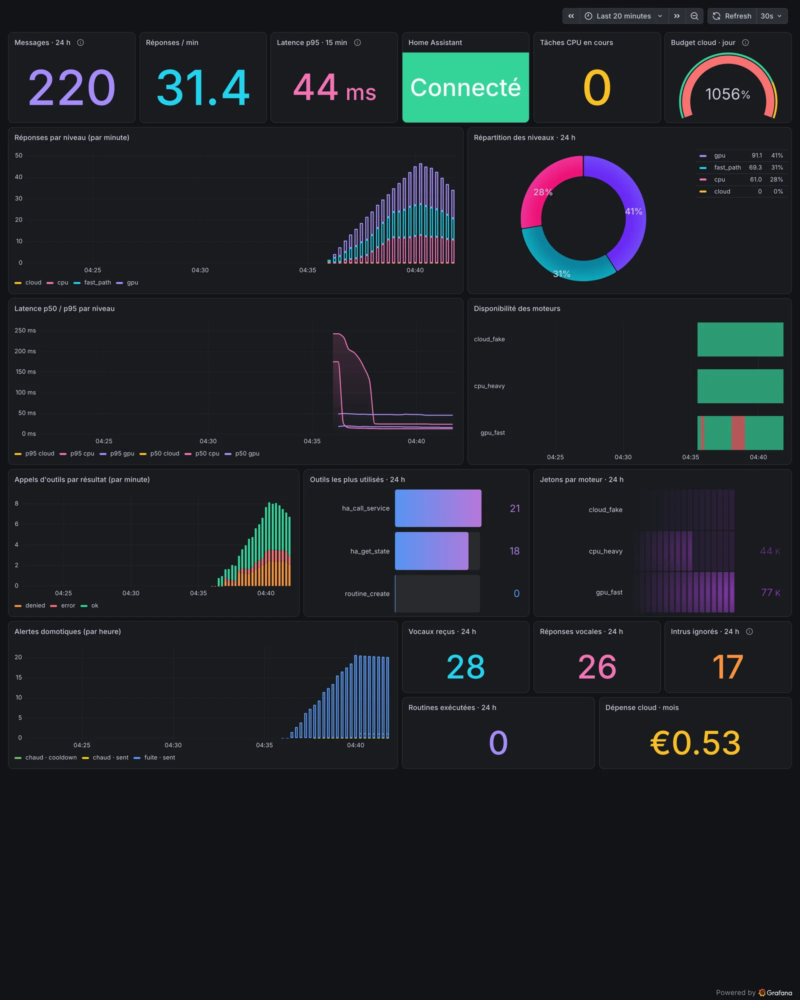

# Supervision : Prometheus + Grafana

L'agent expose ses métriques au format Prometheus sur `/metrics`. Le profil Compose
**`monitoring`** ajoute un Prometheus (30 jours d'historique) et un Grafana avec un tableau de
bord prêt à l'emploi, provisionné automatiquement.



<sub>Capture prise sur la stack de développement (moteurs, Home Assistant et Telegram simulés,
trafic généré par un script). La panne rouge dans « Disponibilité des moteurs » est une panne
simulée du moteur GPU ; la jauge de budget dépasse 100 % parce que le plafond de la config de dev
est minuscule (0,05 €).</sub>

## Mise en route

1. Dans `.env`, vérifiez **`METRICS_TOKEN`** (16 caractères minimum) et **`GRAFANA_ADMIN_PASSWORD`**.
   `make init` les génère au hasard quand il crée `.env` ; sur un `.env` plus ancien, ajoutez-les
   à la main (par exemple `python3 -c "import secrets; print(secrets.token_urlsafe(18))"`).
2. Ajoutez le profil : `make up PROFILE=full,monitoring` (ou `cpu-only,monitoring`, etc.).
3. Ouvrez Grafana sur <http://127.0.0.1:3000> (utilisateur `admin`) : le tableau de bord
   **homelab-agent** est la page d'accueil.
4. Facultatif : un lien « Grafana » dans la barre du panneau avec
   `web.grafana_url: http://127.0.0.1:3000` dans `config.yaml`.

Grafana n'est publié que sur `127.0.0.1` de l'hôte, comme le panneau. Prometheus n'est pas publié
du tout : il n'est joignable que depuis le réseau Compose.

### Démo sans matériel

```bash
make dev-monitoring
```

Lance la stack de dev (faux services) avec Prometheus et Grafana : panneau sur
<http://127.0.0.1:8099> (`dev-password-123`), Grafana sur <http://127.0.0.1:3000>
(`admin` / `change-me-grafana`, mot de passe de démo uniquement). Envoyez quelques messages depuis le
chat du panneau pour voir les courbes bouger. `make dev-down` arrête tout.

## Le jeton de collecte

`/metrics` demande une authentification, comme le reste du panneau. Prometheus utilise
`METRICS_TOKEN` en `Authorization: Bearer …` :

- ce jeton **n'ouvre que `GET /metrics`** : il ne donne accès ni au panneau, ni à l'API, ni au
  chat ;
- il est lu par l'agent dans la variable nommée par `web.metrics_token_env` (`METRICS_TOKEN` par
  défaut ; `null` pour désactiver la collecte par jeton) ;
- un jeton absent ou trop court (moins de 16 caractères) est refusé : la collecte échoue, rien
  n'est ouvert par erreur ;
- le conteneur Prometheus l'écrit dans un fichier en mémoire (`tmpfs`) au démarrage, il n'apparaît
  pas dans `prometheus.yml`.

Pour un Prometheus déjà en place ailleurs, ajoutez une cible équivalente à
[`deploy/monitoring/prometheus.yml`](../deploy/monitoring/prometheus.yml) ; le panneau doit alors
être joignable depuis ce Prometheus (ce qui sort du cadre « 127.0.0.1 uniquement » par défaut :
à faire derrière un reverse proxy TLS, voir [deployment.md](deployment.md)).

## Le tableau de bord

| Panneau | Ce qu'il montre |
|---|---|
| Messages · 24 h, Réponses / min | volume de demandes (Telegram, chat web, routines) |
| Latence p95 · 15 min | temps de réponse des réponses immédiates (hors tâches CPU) |
| Home Assistant | connexion WebSocket en direct ou non |
| Tâches CPU en cours | file d'attente du moteur lourd |
| Budget cloud · jour | dépense du jour en % du plafond (vert, orange à 80 %, rouge à 100 %) |
| Réponses par niveau | barres empilées chemin rapide / GPU / CPU / cloud |
| Répartition des niveaux · 24 h | qui répond, en proportion |
| Latence p50 / p95 par niveau | calculée sur les histogrammes `hla_latency_ms` |
| Disponibilité des moteurs | frise vert / rouge par moteur (sondes de santé) |
| Appels d'outils par résultat | succès, refus de permission, erreurs |
| Outils les plus utilisés, Jetons par moteur | classements sur 24 h |
| Alertes domotiques | alertes envoyées, en heures calmes ou bloquées par l'anti-répétition |
| Vocaux, réponses vocales, intrus, routines, dépense du mois | compteurs sur 24 h / 30 jours |

Le JSON du tableau de bord est **généré** par
[`scripts/grafana_dashboard.py`](../scripts/grafana_dashboard.py) : modifiez le script puis
`uv run python scripts/grafana_dashboard.py`. La CI vérifie que le JSON est à jour et que chaque
requête n'utilise que des métriques réellement exposées par l'agent.

## Métriques exposées

Toutes préfixées par `hla_` :

| Métrique | Type | Étiquettes |
|---|---|---|
| `messages_total` | compteur | — |
| `replies_total` | compteur | `tier` |
| `latency_ms` | histogramme | `tier` |
| `tokens_total` | compteur | `backend` (entrée + sortie) |
| `tool_calls_total` | compteur | `tool`, `outcome` |
| `alerts_total` | compteur | `alert`, `outcome` |
| `routines_total` | compteur | `routine` |
| `voice_messages_total`, `voice_replies_total`, `telegram_rejected_total` | compteurs | — |
| `backend_up` | jauge | `backend`, `tier` |
| `home_assistant_connected`, `home_assistant_entities` | jauges | — |
| `jobs` | jauge | `status` |
| `cloud_spend_eur`, `cloud_limit_eur` | jauges | `period` (`day`, `month`) |
| `cloud_enabled`, `build_info` | jauges | `version` pour `build_info` |

Les compteurs repartent de zéro au redémarrage de l'agent (comportement normal de Prometheus :
utilisez `rate()` / `increase()`). Aucune métrique ne contient de texte de message, de nom
d'entité Home Assistant ni d'identifiant Telegram.
